# 🧮 Mini NPU 시뮬레이터 (E1-3)

숫자로 된 그림(패턴)과 필터를 같은 위치끼리 곱하고 더하는 **MAC 연산**으로 십자가(Cross)와 X를 판별하고, 크기에 따른 연산 시간을 측정하는 Python 콘솔 프로그램입니다.

- GitHub: https://github.com/ilililililil4319/E1-3
- 미션: AI가 계산하는 방식을 흉내 내는 작은 계산기 만들기 — 올인원 1기 입학 연수 E1-3
- 실행 로그: [docs/logs/](docs/logs/)
- 스크린샷: [docs/screenshots/](docs/screenshots/)
- 환경 세팅: [docs/SETUP.md](docs/SETUP.md)

> **미션 README 최소 템플릿 바로가기**
> 실행 방법 → [14장](#14-로컬-실행-방법) · 구현 요약 → [8장](#8-검증-방법-및-핵심-개념-요약-구현-요약) · 결과 리포트 → [12-11](#12-11-결과-리포트-실패-원인-분석--시간-복잡도-분석)

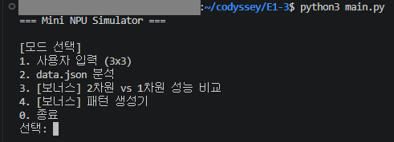

## 목차

1. [프로젝트 소개](#1-프로젝트-소개)
2. [핵심 질문](#2-핵심-질문)
3. [프로젝트 개요 및 산출물 구성](#3-프로젝트-개요-및-산출물-구성)
4. [폴더 구조 (파일 구조)](#4-폴더-구조-파일-구조)
5. [용어 설명 (초보자를 위한 참고)](#5-용어-설명-초보자를-위한-참고)
6. [기술 스택 및 실행 환경](#6-기술-스택-및-실행-환경)
7. [사용 자료·이미지 및 출처](#7-사용-자료이미지-및-출처)
8. [검증 방법 및 핵심 개념 요약 (구현 요약)](#8-검증-방법-및-핵심-개념-요약-구현-요약)
9. [전체 작업 순서 (STEP)](#9-전체-작업-순서-step)
10. [작업 흐름도](#10-작업-흐름도)
11. [구조도](#11-구조도)
12. [핵심 실습 결과 및 결과 리포트](#12-핵심-실습-결과-및-결과-리포트)
13. [보너스 과제](#13-보너스-과제)
14. [로컬 실행 방법](#14-로컬-실행-방법)
15. [환경 변수 및 설정 (데이터 파일 설명)](#15-환경-변수-및-설정-데이터-파일-설명)
16. [실습 중 발생한 오류와 해결](#16-실습-중-발생한-오류와-해결)
17. [AI(Claude) 사용 로그 요약](#17-aiclaude-사용-로그-요약)
18. [기능요구사항 대비 결과](#18-기능요구사항-대비-결과)
19. [결론 및 한계점](#19-결론-및-한계점)
20. [보안 유의사항](#20-보안-유의사항)
21. [출처 및 라이선스 유의사항](#21-출처-및-라이선스-유의사항)
22. [기타](#22-기타)

---

## 1. 프로젝트 소개

| 항목 | 내용 |
| --- | --- |
| 미션 목표 | AI 칩(NPU)이 하는 가장 기본 계산인 MAC 연산을<br>반복문으로 직접 만들고, 크기가 커질 때<br>시간이 어떻게 늘어나는지 측정해 설명한다 |
| 핵심 도구 | Python 3 (표준 라이브러리만), Git, GitHub |
| 핵심 가치 | 외부 라이브러리 없이 원리 그대로 구현,<br>잘못된 데이터에도 멈추지 않는 프로그램,<br>숫자 오차를 정직하게 다루는 비교 정책 |

### 기능 목록

| 메뉴 | 기능 |
| --- | --- |
| 1. 사용자 입력 (3x3) | 필터 A, B와 패턴을 한 줄씩 입력<br>→ A, B 점수, 연산 시간, 판정(A/B/판정 불가)<br>→ 3×3 성능 표 |
| 2. data.json 분석 | 필터 3종 로드 → 패턴 6개 검증, 판정<br>→ PASS/FAIL → 크기별 성능 표<br>→ 결과 요약 (총/통과/실패, 실패 이유) |
| 3. [보너스] 성능 비교 | 2차원 MAC과 1차원 MAC을<br>같은 입력, 같은 반복 횟수로 비교 |
| 4. [보너스] 패턴 생성기 | N을 입력하면 N×N Cross, X 생성<br>→ 판정 확인 → 성능 측정 |
| 0. 종료 | 프로그램 종료 |

## 2. 핵심 질문

미션의 "스스로 설명할 수 있어야 한다" 항목과 한 줄 답입니다.

- **MAC 연산이 무엇이고, AI에서 왜 중요한가?**
  → 같은 위치끼리 곱하고(Multiply) 그 결과를 계속 더하는(Accumulate) 계산이다. AI 모델은 이 계산을 수억 번 반복하므로, 이것을 얼마나 빨리 하느냐가 AI의 속도를 정한다. 그래서 MAC을 한꺼번에 처리하는 전용 칩(NPU)이 생겼다.
- **입력 패턴과 필터로 유사도(점수)를 계산하는 원리는?**
  → 두 그림을 겹쳐 같은 칸끼리 곱하면, 둘 다 1인 칸만 1이 남는다. 다 더한 값이 "겹치는 칸 수"가 되므로 클수록 비슷하다. 십자가 × 십자가 = 5, 십자가 × X = 1.
- **data.json의 키 규칙·라벨 규칙과 라벨을 정규화하는 이유는?**
  → 패턴 키 `size_13_2`의 13이 "13×13 필터를 쓰라"는 뜻이다. 라벨은 파일 안에서 `+`, `cross`, `x`처럼 모양이 제각각이라, 프로그램 안에서는 `Cross`, `X` 두 가지로 통일해야 같은 뜻을 같은 값으로 비교할 수 있다. 통일하지 않으면 `'+' == 'Cross'`가 거짓이 되어 맞는 판정도 FAIL이 된다.
- **부동소수점 오차가 판정에 주는 영향과 epsilon 비교가 필요한 이유는?**
  → 컴퓨터는 0.1을 정확히 저장하지 못해 `0.1을 9번 더한 값`이 0.9가 아니라 0.8999999999999999가 된다. `==`나 `>`로 비교하면 이 0.0000000000000001 차이가 승패를 정해 버린다. 차이가 1e-9보다 작으면 "같다"고 보는 epsilon 비교로 이런 가짜 승패를 막는다.
- **크기별 연산 시간과 O(N²)의 근거는?**
  → N×N 배열은 칸이 N²개이고, 칸마다 곱셈 1번 + 덧셈 1번을 한다. N이 2배가 되면 칸은 4배가 되고, 내 PC 측정에서도 N=25→50→100→200에서 시간이 평균 약 3.7배씩(3.0~5.1배) 늘었다 ([14_scale.md](docs/logs/14_scale.md)).
- **실패 원인을 데이터·로직·수치 비교 문제로 나누어 진단하는 방법은?**
  → ① 데이터/스키마: 키·라벨·크기·숫자 형식이 맞는지 먼저 검사해 이유를 남긴다. ② 로직: 답을 아는 예시(십자가×십자가=5)로 MAC을 검증한다. ③ 수치 비교: 두 점수의 차이를 출력해 1e-16 같은 오차 수준인지 본다. 이 저장소의 실패 3건은 ①, ②를 통과했고 ③에서 "점수가 수학적으로 같다"로 진단되었다 ([12-11](#12-11-결과-리포트-실패-원인-분석--시간-복잡도-분석)).

## 3. 프로젝트 개요 및 산출물 구성

| 최종 결과물 | 저장소 위치 |
| --- | --- |
| 실행 파일 | [main.py](main.py) |
| 시뮬레이터 코드 | [app/](app/) |
| 미션 데이터 | [data.json](data.json) |
| 단위 테스트 | [tests/](tests/) |
| 실습 스크립트 | [scripts/](scripts/) |
| 실행 로그 (명령 + 출력) | [docs/logs/](docs/logs/) |
| 스크린샷 | [docs/screenshots/](docs/screenshots/) |
| 환경 세팅 문서 | [docs/SETUP.md](docs/SETUP.md) |
| 결과 리포트 | 이 문서 [12-11](#12-11-결과-리포트-실패-원인-분석--시간-복잡도-분석) |

## 4. 폴더 구조 (파일 구조)

```
E1-3/
├── README.md              # 기술 문서 + 결과 리포트 (이 파일)
├── .gitignore             # .demo/, 캐시, .env, 키 파일 제외
├── main.py                # 시작점: 모드 선택 메뉴
├── data.json              # 미션 데이터 (필터 3종, 패턴 6개)
├── app/                   # 시뮬레이터 코드
│   ├── __init__.py
│   ├── matrix.py          # Matrix: n×n 숫자 배열 (get/set, 검증, 1차원 변환)
│   ├── mac.py             # mac(2차원), mac_flat(1차원) - 반복문 직접 구현
│   ├── labels.py          # 라벨 정규화: +, cross → Cross / x → X
│   ├── judge.py           # epsilon(1e-9) 비교와 판정
│   ├── console.py         # 입력(재입력 유도), 제목 줄, 한글 폭 맞추기
│   ├── dataset.py         # data.json 로드, 키에서 N 추출, 스키마 검증
│   ├── perf.py            # 10회 반복 평균 ms 측정, 성능 표
│   ├── report.py          # 결과 요약 (총/통과/실패, 실패 이유)
│   ├── generator.py       # [보너스] N×N Cross, X 생성기
│   └── modes.py           # 모드 1, 2와 보너스 메뉴의 실행 흐름
├── tests/                 # 단위 테스트 (unittest, 18개)
│   ├── test_core.py       # Matrix, 입력, MAC, 라벨, epsilon
│   └── test_dataset.py    # data.json, 망가진 케이스, 파일 오류
├── scripts/
│   ├── lib.sh             # run/try/check/note/section, 마스킹, 실패 시 [중단]
│   ├── 00_env.sh          # 실행 환경
│   ├── 01_data_structure.sh ~ 11_flow.sh   # 기능 요구사항 1~10 순서
│   ├── 12_bonus_flat.sh, 13_bonus_generator.sh   # 보너스
│   ├── 14_scale.sh        # 대량 데이터 (케이스 1천~10만, N 25~200)
│   ├── 15_unittest.sh     # 단위 테스트 전체
│   ├── 16_git_history.sh  # 커밋, 브랜치, 병합 이력
│   ├── make_broken.py     # 04번이 쓰는 "일부러 망가뜨린 data.json" 생성기
│   ├── bench_scale.py     # 14번이 쓰는 측정 프로그램
│   └── run_all.sh         # 전부 순서대로 실행
└── docs/
    ├── SETUP.md           # 환경 세팅 (Windows WSL2 기준)
    ├── logs/              # 스크립트 출력 (자동)
    └── screenshots/       # 캡처
```

## 5. 용어 설명 (초보자를 위한 참고)

이 미션에서 새로 쓴 용어와 명령입니다. 앞 과제에서 설명한 명령은 [E1-1 README 5장](https://github.com/ilililililil4319/E1-1#5-용어-설명-초보자를-위한-참고)(pwd, ls, cd, git add 등)과 [E1-2 README 5장](https://github.com/ilililililil4319/E1-2#5-용어-설명-초보자를-위한-참고)(grep, head, tail, printf, try/except, json.load, git merge --no-ff 등)에 있습니다.

> **읽는 법**: `[ ]` 안은 소리 내어 읽는 방법
> **띄어쓰기 표시**: 명령 사이의 붉은 $`\color{red}{\vee}`$ 는 **띄어쓰기 한 칸**입니다. 예) `python3` $`\color{red}{\vee}`$ `-m` $`\color{red}{\vee}`$ `unittest` = 파이썬쓰리 / 띄어쓰기 / 대시 엠 / 띄어쓰기 / 유닛테스트

### 5-1. AI와 계산 개념

| 용어 [읽는 법] | 뜻 |
| --- | --- |
| 패턴 (Pattern)<br>[패턴] | 판별하고 싶은 입력 그림을 숫자 배열로 바꾼 것 |
| 필터 (Filter)<br>[필터] | "이런 모양이면 십자가"처럼 기준을 숫자 배열로 정한 것 |
| MAC<br>[맥, 멀티플라이 어큐뮬레이트] | 같은 위치끼리 곱하고(M) 계속 더하기(A)<br>결과가 유사도 점수 |
| 2차원 배열 / 행렬<br>[이차원 배열 / 행렬] | 가로줄(행)과 세로줄(열)이 있는 숫자 표 |
| 행 / 열<br>[행 / 열] | 가로줄 / 세로줄. `m[행][열]`, 0부터 센다 |
| NPU<br>[엔피유, 뉴럴 프로세싱 유닛] | MAC 연산을 수천 개씩 동시에 하는 AI 전용 칩 |
| 직렬 / 병렬<br>[직렬 / 병렬] | 하나씩 차례로 / 여러 개를 동시에<br>CPU의 Python 코드는 직렬, NPU는 병렬 |
| 부동소수점 (float)<br>[부동소수점, 플로트] | 소수를 2진수로 근사해 저장하는 방식<br>0.1을 정확히 못 담아 아주 작은 오차가 생김 |
| epsilon (ε)<br>[엡실론] | "이 정도 차이는 같은 것으로 본다"는 허용오차<br>이 저장소는 `1e-9` (0.000000001) |
| `1e-9`<br>[일 이 마이너스 구] | 1 × 10⁻⁹ = 0.000000001 |
| 동점 / UNDECIDED<br>[언디사이디드] | 두 점수 차이가 epsilon보다 작아<br>판정할 수 없음 |
| 라벨 / 정규화<br>[라벨 / 정규화] | 정답 이름표 / 여러 모양의 이름표를<br>표준 하나(Cross, X)로 통일하기 |
| 스키마 (Schema)<br>[스키마] | 데이터가 지켜야 할 구조 약속<br>(어떤 키, 어떤 모양의 값) |
| expected<br>[익스펙티드] | 데이터에 적힌 정답 (기대값) |
| PASS / FAIL<br>[패스 / 페일] | 판정이 정답과 같음 / 다름 |
| 시간 복잡도 O(N²)<br>[빅오 엔 제곱] | 입력 크기 N이 커질 때 일의 양이 N²에 비례 |
| ms (밀리초)<br>[밀리세컨드] | 1/1000초 |
| 평균 (반복 측정)<br>[평균] | 시간은 잴 때마다 흔들리므로<br>여러 번 재서 나눈 값 |

### 5-2. Python

| 코드 [읽는 법] | 뜻 |
| --- | --- |
| `float("0.5")`<br>[플로트] | 글자를 소수로 바꾸기<br>숫자가 아니면 `ValueError` |
| `abs(a` $`\color{red}{\vee}`$ `-` $`\color{red}{\vee}`$ `b)`<br>[앱스] | 절댓값 (차이를 양수로) |
| `repr(0.9)`<br>[레퍼] | 값을 생략 없이 그대로 보여 주기<br>(`0.8999999999999999`) |
| `math.isfinite(x)`<br>[매스 점 이즈파이나이트] | NaN(숫자 아님), inf(무한대)가 아닌지 확인 |
| `time.perf_counter()`<br>[타임 점 퍼프 카운터] | 짧은 시간을 재는 가장 정밀한 시계 |
| `re.match(패턴,` $`\color{red}{\vee}`$ `"size_13_2")`<br>[리 점 매치] | 정규표현식(패턴)으로 글자 모양 검사<br>패턴 `size_(\d+)_(\d+)`에서<br>`(\d+)` = 숫자 묶음을 꺼냄 |
| `@classmethod`<br>[클래스메서드] | 객체 없이 클래스로 부르는 메서드<br>`Matrix.from_rows(...)`처럼 "만드는 방법"에 사용 |
| `isinstance(v,` $`\color{red}{\vee}`$ `(int,` $`\color{red}{\vee}`$ `float))`<br>[이즈인스턴스] | 값이 그 종류인지 확인 |
| `zip`, `enumerate`<br>[집 / 이뉴머레이트] | 두 목록을 짝지어 돌기 / 번호와 함께 돌기 |
| `unittest`<br>[유닛테스트] | 표준 라이브러리 자동 테스트 도구 |
| `assertEqual`, `assertRaises`<br>[어설트 이퀄 / 어설트 레이지즈] | 같아야 한다 / 이 오류가 나야 한다 |
| `raise` $`\color{red}{\vee}`$ `ValueError("이유")`<br>[레이즈 밸류 에러] | 오류를 일부러 일으켜 이유 전달 |
| 패키지 (`app/__init__.py`)<br>[패키지, 던더 이닛] | 파일 여러 개를 묶은 폴더<br>`from` $`\color{red}{\vee}`$ `app.mac` $`\color{red}{\vee}`$ `import` $`\color{red}{\vee}`$ `mac`<br>처럼 불러옴 |

### 5-3. 터미널 (앞 과제에 없던 명령)

| 명령 [읽는 법] | 뜻 |
| --- | --- |
| `python3` $`\color{red}{\vee}`$ `-m` $`\color{red}{\vee}`$ `unittest` $`\color{red}{\vee}`$ `-v`<br>[파이썬쓰리 대시 엠 유닛테스트 대시 브이] | `tests/`의 테스트를 모두 실행<br>`-v`는 테스트 이름까지 자세히 |
| `python3` $`\color{red}{\vee}`$ `-c` $`\color{red}{\vee}`$ `'print(0.1` $`\color{red}{\vee}`$ `+` $`\color{red}{\vee}`$ `0.2)'`<br>[파이썬쓰리 대시 씨] | 파일 없이 Python 한 줄 실행 |
| `NPU_DATA_PATH=x.json` $`\color{red}{\vee}`$ `python3` $`\color{red}{\vee}`$ `main.py`<br>[엔피유 데이터 패스 이퀄 …] | 이 명령 한 번에만 환경 변수 지정 |
| `sed` $`\color{red}{\vee}`$ `-n` $`\color{red}{\vee}`$ `'5,10p'` $`\color{red}{\vee}`$ `main.py`<br>[세드 대시 엔 오 콤마 십 피] | 파일의 5~10번째 줄만 출력 |
| `sed` $`\color{red}{\vee}`$ `-n` $`\color{red}{\vee}`$ `'/시작/,/끝/p'` $`\color{red}{\vee}`$ `파일`<br>[세드 대시 엔] | "시작"이 있는 줄부터<br>"끝"이 있는 줄까지 출력 |
| `sort`<br>[소트] | 줄을 정렬 |
| `uniq` $`\color{red}{\vee}`$ `-c`<br>[유니크 대시 씨] | 연속된 같은 줄을 하나로<br>합치고 개수 표시<br>(보통 `sort` 다음에 씀) |
| `grep` $`\color{red}{\vee}`$ `-c` $`\color{red}{\vee}`$ `'PASS'`<br>[그렙 대시 씨] | 찾은 줄의 **개수**만 출력 |
| `grep` $`\color{red}{\vee}`$ `-A1` $`\color{red}{\vee}`$ `'문구'`<br>[그렙 대시 대문자 에이 일] | 찾은 줄 + 그 **아래(After)** 1줄 |
| `grep` $`\color{red}{\vee}`$ `-oE` $`\color{red}{\vee}`$ `'PASS\|FAIL'`<br>[그렙 대시 오 대문자 이] | 줄 전체가 아니라 맞는 부분만(`-o`)<br>`-E`는 `\|`(또는) 같은 확장 문법 |
| `time` $`\color{red}{\vee}`$ `python3` $`\color{red}{\vee}`$ `main.py`<br>[타임] | 명령이 걸린 시간 측정<br>(real = 실제 시간) |
| `nproc`<br>[엔프록] | CPU 코어 수 |

### 5-4. Git (앞 과제에 없던 명령)

| 명령 [읽는 법] | 뜻 |
| --- | --- |
| `git` $`\color{red}{\vee}`$ `log` $`\color{red}{\vee}`$ `--merges` $`\color{red}{\vee}`$ `--oneline`<br>[깃 로그 대시대시 머지스 대시대시 원라인] | 병합 커밋만 보기 |
| `git` $`\color{red}{\vee}`$ `log` $`\color{red}{\vee}`$ `--format='%h` $`\color{red}{\vee}`$ `%an` $`\color{red}{\vee}`$ `%s'`<br>[깃 로그 대시대시 포맷] | 원하는 칸만: 짧은 해시, 작성자, 제목 |
| `git` $`\color{red}{\vee}`$ `log` $`\color{red}{\vee}`$ `--all`<br>[깃 로그 대시대시 올] | 모든 브랜치의 커밋 |
| `git` $`\color{red}{\vee}`$ `push` $`\color{red}{\vee}`$ `-u` $`\color{red}{\vee}`$ `origin` $`\color{red}{\vee}`$ `main` $`\color{red}{\vee}`$ `feature/a`<br>[깃 푸시 대시 유 오리진 메인 피처 슬래시 에이] | 여러 브랜치를 한 번에 올리기 |
| `git` $`\color{red}{\vee}`$ `branch` $`\color{red}{\vee}`$ `-r`<br>[깃 브랜치 대시 알] | 원격(GitHub) 브랜치만 보기 |
| `git` $`\color{red}{\vee}`$ `switch` $`\color{red}{\vee}`$ `main`<br>[깃 스위치 메인] | main 브랜치로 이동 (`checkout`의 새 문법) |

### 5-5. 헷갈리기 쉬운 명령과 개념

| 비교 | 차이 |
| --- | --- |
| `==`<br>`abs(a` $`\color{red}{\vee}`$ `-` $`\color{red}{\vee}`$ `b)` $`\color{red}{\vee}`$ `<` $`\color{red}{\vee}`$ `1e-9` | `==`: 끝자리까지 완전히 같아야 참<br>epsilon: 차이가 아주 작으면 같다고 봄 |
| `print(0.9)`<br>`repr(값)` | 둘 다 짧게 보이지만<br>`repr`은 오차까지 그대로 보여 줌 |
| `time.time()`<br>`time.perf_counter()` | 지금 시각(날짜용)<br>짧은 구간 재기(측정용, 더 정밀) |
| `int("3")`<br>`float("3")` | 정수 3 / 소수 3.0<br>`int("0.5")`는 오류, `float("0.5")`는 됨 |
| `m[1][2]`<br>`flat[1*N+2]` | 2차원: 행 1, 열 2<br>1차원: 같은 칸을 인덱스 하나로 |
| `grep` $`\color{red}{\vee}`$ `-c`<br>`wc` $`\color{red}{\vee}`$ `-l` | 찾은 줄 개수 / 전체 줄 개수 |
| `grep` $`\color{red}{\vee}`$ `-A1`<br>`grep` $`\color{red}{\vee}`$ `-B1` | 찾은 줄 + 아래 1줄 / 찾은 줄 + 위 1줄 |
| `python3` $`\color{red}{\vee}`$ `-c`<br>`python3` $`\color{red}{\vee}`$ `-m` | 코드 한 줄 실행 / 모듈(도구) 실행 |
| `export` $`\color{red}{\vee}`$ `X=1`<br>`X=1` $`\color{red}{\vee}`$ `명령` | 터미널을 닫을 때까지 유지<br>그 명령 한 번만 |
| `git` $`\color{red}{\vee}`$ `merge`<br>`git` $`\color{red}{\vee}`$ `merge` $`\color{red}{\vee}`$ `--no-ff` | 가능하면 줄만 앞으로(이력 한 줄)<br>병합 커밋을 꼭 남김(갈래가 보임) |
| `git` $`\color{red}{\vee}`$ `checkout` $`\color{red}{\vee}`$ `main`<br>`git` $`\color{red}{\vee}`$ `switch` $`\color{red}{\vee}`$ `main` | 같은 일 (switch가 새 문법) |
| O(N)<br>O(N²) | N이 2배면 2배 / N이 2배면 4배 |

## 6. 기술 스택 및 실행 환경

| 도구 | 버전 | 용도 |
| --- | --- | --- |
| OS | Windows + WSL2<br>Ubuntu 26.04.1 LTS | 실행 환경 |
| Python | 3.14.4<br>(요구: 3.8 이상) | 시뮬레이터 실행 |
| Git | 2.53.0 | 버전 관리 |
| VSCode (WSL 확장) | - | 편집, 터미널 |
| 외부 라이브러리 | 없음 | 표준 라이브러리만<br>`json`, `time`, `math`, `re`,<br>`os`, `sys`, `unicodedata` |

버전 출처: [00_env.md](docs/logs/00_env.md) (집 PC에서 실행)

| Python 버전 | Git 설정, 원격 저장소 |
| --- | --- |
| 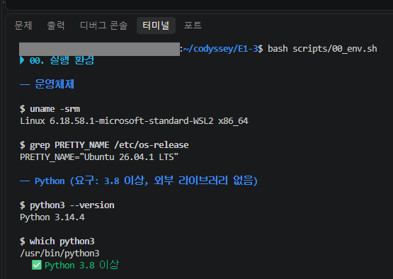 | 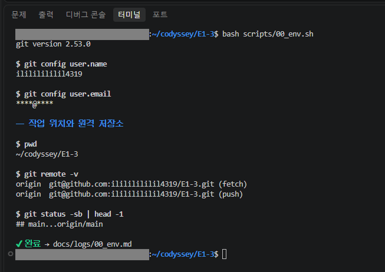 |

## 7. 사용 자료·이미지 및 출처

| 자료 | 출처 | 비고 |
| --- | --- | --- |
| `data.json` | 미션 제공 데이터 | 수정하지 않고 그대로 사용 |
| Python 표준 라이브러리 | [docs.python.org](https://docs.python.org/3/library/) | 별도 설치 없음 |
| 스크린샷 | 직접 캡처 | 아이디, 컴퓨터 이름 가림 |

외부 패키지를 쓰지 않으므로 고정할 버전이 없고, Python 3.8 이상이면 같은 점수·판정이 나옵니다. (시간(ms)은 PC마다 다릅니다)

## 8. 검증 방법 및 핵심 개념 요약 (구현 요약)

### 구현 요약

| 항목 | 구현 |
| --- | --- |
| 데이터 구조 | `Matrix` 클래스: 내부는 2차원 리스트<br>`get(행, 열)`, `set(행, 열, 값)`<br>정사각형, 숫자(NaN, bool 제외) 검사 |
| MAC 연산 | 이중 `for`문으로 N×N번 곱하고 더함<br>`total += p[r][c] * f[r][c]`<br>NumPy 없음 → [app/mac.py](app/mac.py) |
| 라벨 정규화 | 앞뒤 공백 제거 + 소문자로 바꾼 뒤 표에서 찾기<br>`+`, `cross` → `Cross` / `x` → `X`<br>필터 키와 expected 모두 같은 함수 |
| 동점 정책 | `abs(a - b) < 1e-9`이면 동점<br>모드 1은 "판정 불가", 모드 2는 `UNDECIDED`<br>`UNDECIDED`는 expected와 다르므로 FAIL |
| 스키마 검증 | 케이스마다 키 형식 → 필터 존재 → 항목 존재<br>→ 라벨 → 숫자 배열 → 크기 순서로 검사<br>문제가 있으면 그 케이스만 FAIL + 이유 |
| 시간 측정 | 워밍업 1회 뒤 `perf_counter`로<br>함수 호출만 10회 재서 평균 (입출력 제외) |

### 검증 원칙

1. 요구사항 하나당 스크립트 하나: `scripts/NN_*.sh`가 명령을 실행하고 명령+출력을 `docs/logs/NN_*.md`에 남긴다.
2. 눈으로만 보지 않는다: `check`가 점수, PASS 개수, 안내 문구를 조건으로 확인해 ✅/❌를 남긴다.
3. 답을 아는 예시로 먼저 검증: 미션의 Case 1(5점), Case 2(1점)가 그대로 나오는지 확인한 뒤 data.json을 분석했다.
4. 일부러 망가뜨린 파일로 실험: 진짜 `data.json`은 그대로 두고 `.demo/`에 망가진 복사본을 만들어 확인했다.

| 핵심 질문 | 확인 결과 | 증거 |
| --- | --- | --- |
| MAC이 맞게<br>계산되는가 | 십자가×십자가 = 5.0<br>십자가×X = 1.0 | [06_mac.md](docs/logs/06_mac.md) |
| 입력이 틀리면? | 숫자 2개, 4개, 글자, 빈 줄<br>→ 안내 후 그 줄만 재입력 | [02_mode1_input.md](docs/logs/02_mode1_input.md) |
| 라벨이 통일되는가 | `+`, `x` → Cross, X로 출력·비교 | [05_labels.md](docs/logs/05_labels.md) |
| 데이터가 망가지면? | 5종 오류 모두 케이스 FAIL<br>프로그램은 끝까지 실행 | [04_schema_errors.md](docs/logs/04_schema_errors.md) |
| 동점을 어떻게<br>처리하는가 | 차이 1e-16 수준 3건<br>→ UNDECIDED | [07_epsilon.md](docs/logs/07_epsilon.md) |
| 시간이 N²에<br>비례하는가 | N 2배마다 시간<br>평균 약 3.7배 (≈ 4) | [14_scale.md](docs/logs/14_scale.md) |

## 9. 전체 작업 순서 (STEP)

| STEP | 작업 | 증빙 |
| --- | --- | --- |
| 1 | 저장소 생성, `.gitignore`, data.json | [16_git_history.md](docs/logs/16_git_history.md) |
| 2 | `Matrix` → MAC → 라벨 정규화<br>→ epsilon 판정 (main) | [01](docs/logs/01_data_structure.md), [06](docs/logs/06_mac.md),<br>[05](docs/logs/05_labels.md), [07](docs/logs/07_epsilon.md) |
| 3 | 3×3 입력 검증, 모드 1 흐름 | [02_mode1_input.md](docs/logs/02_mode1_input.md) |
| 4 | `feature/json-analysis`에서<br>data.json 검증, 결과 요약, 모드 2<br>→ main 병합 | [03](docs/logs/03_mode2_json.md), [04](docs/logs/04_schema_errors.md),<br>[08](docs/logs/08_judge_passfail.md), [10](docs/logs/10_report.md) |
| 5 | `feature/performance`에서<br>생성기, 1차원 MAC, 성능 측정<br>→ main 병합 | [09](docs/logs/09_performance.md), [12](docs/logs/12_bonus_flat.md),<br>[13](docs/logs/13_bonus_generator.md) |
| 6 | 단위 테스트, 실습 스크립트,<br>대량 데이터 측정 | [15](docs/logs/15_unittest.md), [14](docs/logs/14_scale.md) |
| 7 | README, 결과 리포트 | [11_flow.md](docs/logs/11_flow.md) |

## 10. 작업 흐름도

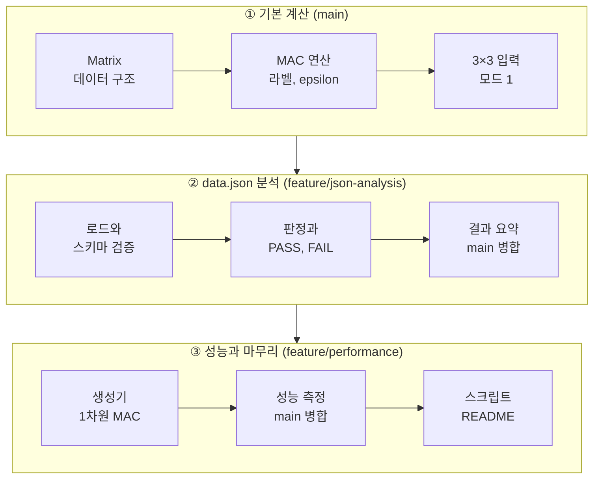

## 11. 구조도

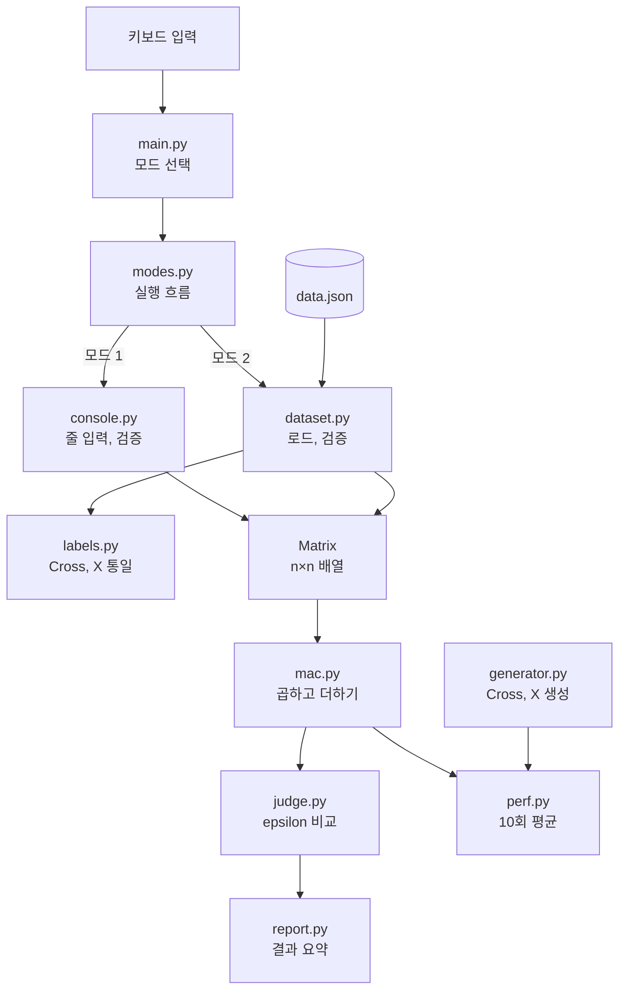

**설계 노트**

- 모드 1과 모드 2가 **같은 `mac()`과 `judge()`**를 쓴다. 입력 방법만 다르고 계산과 비교 규칙은 한 곳에 있어서, 두 모드가 서로 다른 결과를 낼 수 없다.
- 라벨 정규화는 **입구(data.json을 읽는 순간)에서 한 번**만 한다. 그 뒤의 판정, 출력, PASS/FAIL 비교는 모두 `Cross`/`X`만 본다.
- 데이터 검증은 "파일 전체 문제"(파일 없음, JSON 깨짐)와 "케이스 하나 문제"(크기, 키, 라벨)를 나눴다. 파일 문제는 메뉴로 돌아가고, 케이스 문제는 그 케이스만 FAIL로 기록하고 다음 케이스로 넘어간다.
- 성능 측정은 MAC 함수 호출 구간만 잰다. 패턴을 만들고 출력하는 시간은 시계 밖에 둔다.

## 12. 핵심 실습 결과 및 결과 리포트

항목마다 두 가지 증거를 함께 붙였습니다. **시간(ms) 숫자가 서로 다른 것은 정상**입니다.

| 구분 | 어떻게 만들었나 | 차이 나는 것 |
| --- | --- | --- |
| 🤖 **자동 실행 로그** | `scripts/`가 정해진 입력을<br>파이프로 넣어 실행 | 점수, 판정은 항상 같음 |
| 📸 **직접 실행 화면** | 집 PC에서 내가<br>키보드로 입력 | 연산 시간(ms)은<br>실행할 때마다 조금씩 다름 |

### 12-1. 모드 1: 미션 예시 입력 — [02_mode1_input.md](docs/logs/02_mode1_input.md)

🤖 **자동 실행 로그** (필터 A = 십자가, 필터 B = X, 패턴 = X)

```console
#----------------------------------------
# [3] MAC 결과
#----------------------------------------
A 점수: 1.0
B 점수: 5.0
연산 시간(평균/10회): 0.0008 ms
판정: B
```

📸 **직접 실행 화면**

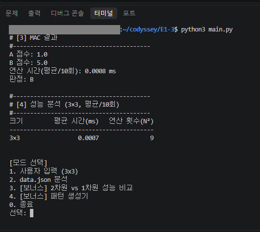

### 12-2. 모드 1: 입력 검증과 재입력 — [02_mode1_input.md](docs/logs/02_mode1_input.md)

🤖 **자동 실행 로그**

```console
필터 A (3줄 입력, 공백 구분)
0 1
  ⚠ 입력 형식 오류: 각 줄에 3개의 숫자를 공백으로 구분해 입력하세요. (입력한 숫자 2개)
  → 1번째 줄을 다시 입력하세요.
0 a 0
  ⚠ 입력 형식 오류: 각 줄에 3개의 숫자를 공백으로 구분해 입력하세요. ('a'은(는) 숫자가 아님)
  → 1번째 줄을 다시 입력하세요.
```

📸 **직접 실행 화면**

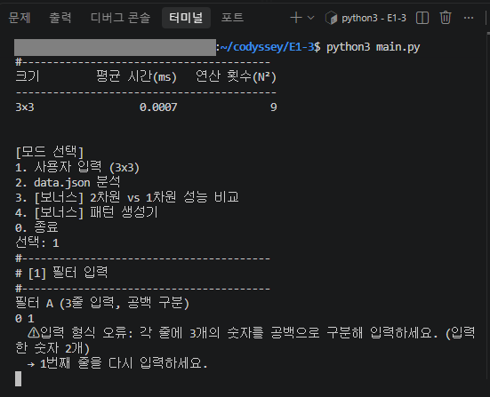

### 12-3. 모드 2: data.json 분석 — [03_mode2_json.md](docs/logs/03_mode2_json.md), [08_judge_passfail.md](docs/logs/08_judge_passfail.md)

🤖 **자동 실행 로그**

```console
✓ size_5 필터 로드 완료 (Cross, X)
✓ size_13 필터 로드 완료 (Cross, X)
✓ size_25 필터 로드 완료 (Cross, X)
--- size_5_1 ---
Cross 점수: 0.9
X 점수: 0.8999999999999999
판정: UNDECIDED | expected: X | FAIL (동점 규칙: |차이| 1.1e-16 < 1e-09)
--- size_5_2 ---
Cross 점수: 8.9
X 점수: 0.1
판정: Cross | expected: Cross | PASS
```

📸 **직접 실행 화면**

| 필터 로드, 패턴 분석 | 동점 케이스, 성능 표 | 성능 표, 결과 요약 |
| --- | --- | --- |
| 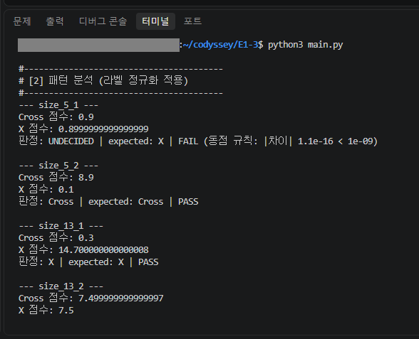 | 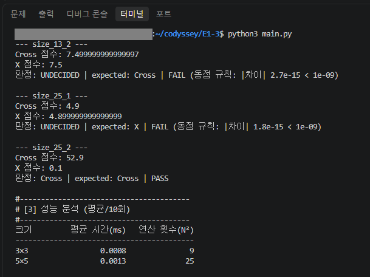 | 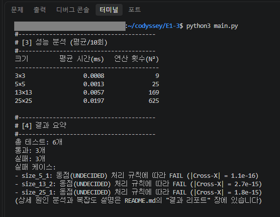 |

### 12-4. 스키마 오류, 크기 불일치 — [04_schema_errors.md](docs/logs/04_schema_errors.md)

진짜 `data.json`을 복사해 망가진 케이스 5개를 넣은 파일(`.demo/broken_cases.json`)로 실행했습니다.

🤖 **자동 실행 로그**

```console
$ printf '2\n0\n' | NPU_DATA_PATH=.demo/broken_cases.json python3 main.py
...
총 테스트: 11개
통과: 3개
실패: 8개
실패 케이스:
- size_5_3: 크기 불일치: 패턴 3×3, 필터 5×5
- size_5_4: 라벨 오류: 알 수 없는 라벨: 'o' (허용: '+', 'cross', 'x')
- size_5_5: 스키마 오류: input 1행 2열 값이 숫자가 아닙니다: '1'
- size_7_1: 필터 없음: size_7 필터가 로드되지 않음
- pattern_A: 키 형식 오류: size_{N}_{idx} 형태가 아님
...
프로그램을 종료합니다.
```

### 12-5. 라벨 정규화 — [05_labels.md](docs/logs/05_labels.md)

🤖 **자동 실행 로그**

```console
$ grep -oE '"expected": "[^"]*"' data.json | sort | uniq -c
      3 "expected": "+"
      3 "expected": "x"
$ printf '2\n0\n' | python3 main.py | grep 'expected:'
판정: UNDECIDED | expected: X | FAIL (...)
판정: Cross | expected: Cross | PASS
```

### 12-6. MAC 연산 — [06_mac.md](docs/logs/06_mac.md)

🤖 **자동 실행 로그** (십자가 × X를 한 칸씩)

```console
0×1  1×0  0×1
1×0  1×1  1×0
0×1  1×0  0×1
합계 = 1.0
```

### 12-7. 부동소수점과 epsilon — [07_epsilon.md](docs/logs/07_epsilon.md)

🤖 **자동 실행 로그**

```console
케이스      Cross점수            X점수                단순비교 epsilon비교
size_5_1    0.9                  0.8999999999999999   Cross    UNDECIDED
size_5_2    8.9                  0.1                  Cross    Cross
size_13_1   0.3                  14.700000000000008   X        X
size_13_2   7.499999999999997    7.5                  X        UNDECIDED
size_25_1   4.9                  4.899999999999999    Cross    UNDECIDED
size_25_2   52.9                 0.1                  Cross    Cross
```

### 12-8. 성능 분석 — [09_performance.md](docs/logs/09_performance.md)

🤖 **자동 실행 로그**

```console
크기         평균 시간(ms)   연산 횟수(N²)
------------------------------------------
3×3                 0.0010               9
5×5                 0.0015              25
13×13               0.0055             169
25×25               0.0256             625
```

### 12-9. 결과 요약 (콘솔) — [10_report.md](docs/logs/10_report.md)

🤖 **자동 실행 로그**

```console
총 테스트: 6개
통과: 3개
실패: 3개
실패 케이스:
- size_5_1: 동점(UNDECIDED) 처리 규칙에 따라 FAIL (|Cross-X| = 1.1e-16)
- size_13_2: 동점(UNDECIDED) 처리 규칙에 따라 FAIL (|Cross-X| = 2.7e-15)
- size_25_1: 동점(UNDECIDED) 처리 규칙에 따라 FAIL (|Cross-X| = 1.8e-15)
```

### 12-10. 실행 흐름과 Git 이력 — [11_flow.md](docs/logs/11_flow.md), [16_git_history.md](docs/logs/16_git_history.md)

🤖 **자동 실행 로그** (모드 2의 단계 순서)

```console
# [1] 필터 로드
# [2] 패턴 분석 (라벨 정규화 적용)
# [3] 성능 분석 (평균/10회)
# [4] 결과 요약
```

📸 **직접 실행 화면**

| `git log --oneline --graph --all` | 전체 스크립트 완료 |
| --- | --- |
| 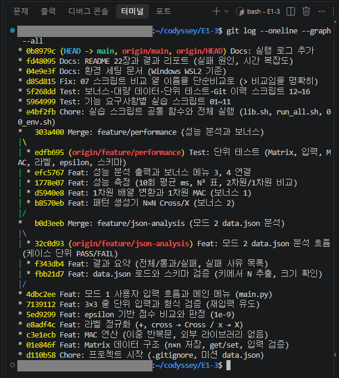 | 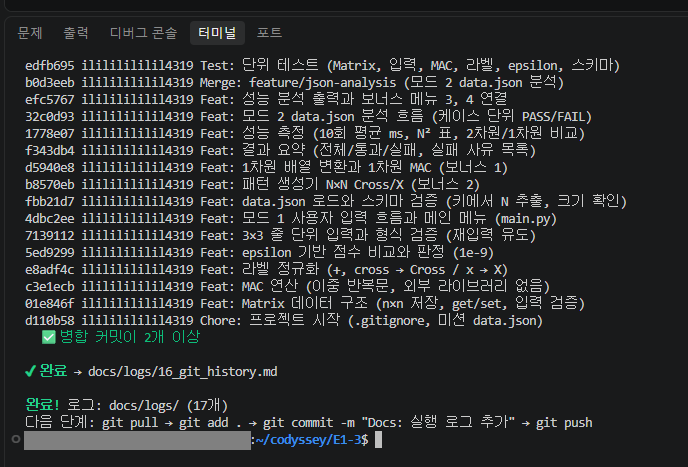 |

### 12-11. 결과 리포트 (실패 원인 분석 + 시간 복잡도 분석)

**결과: 총 6개 / 통과 3개 / 실패 3개.** 실패 3개는 모두 `UNDECIDED`(동점)입니다.

**① 실패 원인 분석 — 데이터/스키마 vs 로직 vs 수치 비교로 나누어 진단**

| 진단 단계 | 확인한 것 | 결과 |
| --- | --- | --- |
| 데이터/스키마 | 키 형식, 필터 존재, 라벨, 숫자, 크기 | 6개 모두 통과<br>(라벨은 정규화로 해결) |
| 로직 | 답을 아는 예시(5점, 1점),<br>2차원과 1차원 결과 비교 | MAC 계산 정상<br>(단위 테스트 18개 통과) |
| 수치 비교 | 두 점수의 차이 크기 | 실패 3건 모두 차이가<br>1e-16 ~ 3e-15 |

1. 실패 3건은 **데이터 형식 문제도, MAC 로직 문제도 아닙니다.** 키·라벨·크기 검증을 모두 통과했고, 같은 MAC 코드가 나머지 3건은 정답으로 판정했습니다.
2. 원인은 **필터 값 자체가 두 점수를 수학적으로 똑같이 만들도록** 되어 있다는 점입니다. 손으로 계산하면 다음과 같습니다.
3. `size_5_1`(X 모양): Cross 필터는 가운데 칸만 겹치고 그 칸이 0.9 → 0.9점. X 필터는 9칸이 겹치고 칸마다 0.1 → 0.1 × 9 = 0.9점. **둘 다 0.9**입니다.
4. `size_13_2`(십자가 모양): Cross 필터는 25칸이 겹치고 칸마다 0.3 → 7.5점. X 필터는 가운데 한 칸만 겹치고 그 칸이 7.5 → 7.5점. **둘 다 7.5**입니다.
5. `size_25_1`(X 모양): Cross 필터는 가운데 한 칸 4.9 → 4.9점. X 필터는 49칸 × 0.1 → 4.9점. **둘 다 4.9**입니다.
6. 그런데 컴퓨터는 0.1, 0.3 같은 소수를 2진수로 정확히 저장하지 못해, 여러 번 더하면 `0.8999999999999999`처럼 끝자리가 조금 어긋납니다.
7. 만약 `>`로 그냥 비교했다면 이 끝자리 오차 때문에 size_5_1은 Cross, size_13_2는 X, size_25_1은 Cross로 **우연히 한쪽이 이기고**, 셋 다 "판정 불일치"로 FAIL이 됩니다 ([07_epsilon.md](docs/logs/07_epsilon.md)의 `단순비교` 열: `>`로 큰 쪽 선택). 그러면 MAC 로직이 틀린 것처럼 보여 원인을 잘못 찾게 됩니다.
8. epsilon(1e-9) 정책을 쓰면 세 경우 모두 "사실상 같은 점수"로 보고 `UNDECIDED`로 판정합니다. 미션 규칙상 `UNDECIDED`는 expected(Cross 또는 X)와 다르므로 FAIL이지만, **실패 이유가 "동점"으로 정확히 남습니다.**
9. epsilon을 키우거나 줄여서 PASS로 만드는 것은 하지 않았습니다. 1e-9보다 작은 차이로 정답을 고르는 것은 계산이 아니라 반올림 운에 맡기는 것이기 때문입니다.
10. 이 FAIL을 없애려면 코드가 아니라 **데이터(필터 가중치)를 고쳐야** 합니다. 예를 들어 Cross 필터와 X 필터의 값 합계를 맞추거나(정규화), 가운데 칸에 몰린 큰 값(7.5, 4.9, 0.9)을 다른 칸과 비슷하게 바꾸면 모양 차이가 점수 차이로 드러납니다.
11. 일부러 망가뜨린 데이터([04_schema_errors.md](docs/logs/04_schema_errors.md))에서는 크기 불일치, 필터 없음, 키 형식, 라벨, 숫자 아님 5종이 **각자의 이유로 FAIL** 되었고 프로그램은 끝까지 실행되었습니다. 즉 데이터 문제는 데이터 문제로, 동점은 동점으로 구분되어 기록됩니다.

**② 시간 복잡도 분석 — O(N²)의 근거**

12. N×N 패턴의 MAC은 모든 칸에서 곱셈 1번, 덧셈 1번을 하므로 연산 횟수가 정확히 **N²**입니다 (3×3 = 9, 25×25 = 625). 그래서 시간 복잡도는 O(N²)입니다.
13. 성능 표(12-8)에서 3×3 → 25×25는 연산 횟수가 약 69배인데 시간은 약 26배만 늘었습니다. 작은 크기에서는 계산보다 **함수 호출·반복문 준비 같은 고정 비용**이 더 크게 섞이기 때문입니다.
14. 고정 비용의 영향이 작아지는 큰 크기에서 따로 측정했습니다 ([14_scale.md](docs/logs/14_scale.md)).

| N | 연산 횟수 N² | 평균(ms) | 앞 줄 대비 |
| ---: | ---: | ---: | ---: |
| 25 | 625 | 0.024 | - |
| 50 | 2,500 | 0.071 | ×3.0 |
| 100 | 10,000 | 0.361 | ×5.1 |
| 200 | 40,000 | 1.173 | ×3.3 |

15. N이 2배가 될 때마다 시간이 3.0~5.1배, 평균 약 **3.7배**로 늘었습니다. 25 → 200(연산 64배)에서 시간은 약 49배입니다. 한 번 잰 값은 PC 상태에 따라 흔들리지만, 평균은 **4배(= 2²)**에 가깝고, 연산 횟수와 시간이 같은 방향·비슷한 비율로 커지므로 O(N²)가 측정으로 확인됩니다.
16. 모드 2 전체는 "케이스 수 K × 필터 2개 × N²"번 계산하므로 O(K·N²)입니다. 크기를 5×5로 고정하고 케이스를 1천 → 1만 → 10만 개로 늘리면 MAC+판정 시간도 약 10배씩 늘었습니다 (19장 표).
17. NPU가 필요한 이유도 여기서 보입니다. N²개의 곱셈은 서로 상관이 없어서 **동시에 할 수 있는데**, Python은 반복문으로 하나씩(직렬) 처리합니다. NPU는 이 곱셈을 수천 개씩 한 번에(병렬) 처리해 같은 일을 훨씬 빨리 끝냅니다.

## 13. 보너스 과제

| 과제 | 수행 내용 | 확인 결과 |
| --- | --- | --- |
| ✅ 1차원 배열<br>최적화<br>[로그](docs/logs/12_bonus_flat.md) | `to_flat()`: (r, c) → r×N+c<br>`mac_flat()`: for문 1개 | 점수는 2차원과 같음<br>작은 N은 1차원이 빠르고<br>큰 N은 오히려 느림 |
| ✅ 패턴 생성기<br>[로그](docs/logs/13_bonus_generator.md) | N 입력 → Cross(가운데 행, 열)<br>X(두 대각선) 자동 생성 | N=5, 7, 25, 51 판정 PASS<br>모드 2 성능 표의<br>3×3에 재활용 |

**1차원 vs 2차원 측정 (같은 입력, 같은 반복 100회)** — [12_bonus_flat.md](docs/logs/12_bonus_flat.md)

```console
크기         2차원(ms)   1차원(ms)   1차원/2차원
------------------------------------------------
3×3             0.0008      0.0004           58%
25×25           0.0204      0.0203           99%
101×101         0.2984      0.3555          119%
```

**왜 큰 크기에서 1차원이 더 느린가?** C 언어나 NPU에서는 한 줄로 이어진 메모리를 순서대로 읽는 1차원 방식이 빠릅니다. 하지만 Python 리스트는 숫자 자체가 아니라 숫자 객체를 가리키는 주소를 담고 있어서 "이어진 메모리" 이점이 거의 없습니다. 오히려 1차원은 인덱스 `i`가 N²까지 커지는데, Python은 256보다 큰 정수를 쓸 때마다 새 정수 객체를 만들어 비용이 늘어납니다. 2차원은 `r`, `c`가 N(101)까지만 커져서 이 비용이 없습니다. **"최적화는 언어와 하드웨어에 따라 다르므로 측정으로 확인해야 한다"**는 것이 이 보너스의 결론입니다.

| 성능 비교 | 패턴 생성기 |
| --- | --- |
| 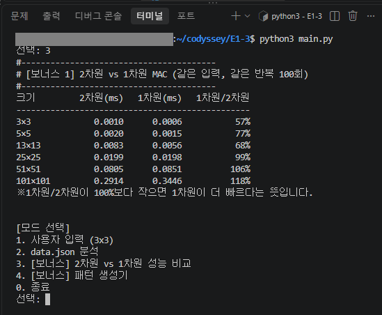 | 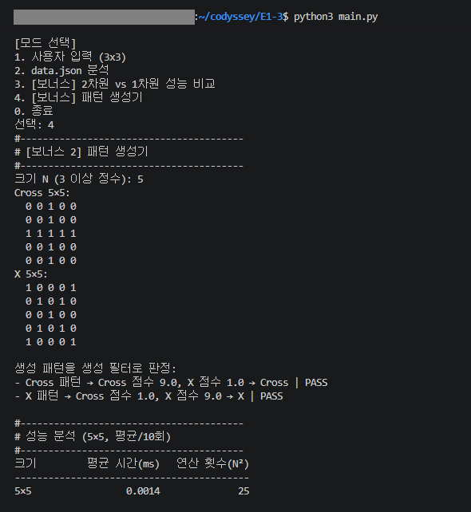 |

## 14. 로컬 실행 방법

```bash
git clone git@github.com:ilililililil4319/E1-3.git
cd E1-3
python3 --version          # 3.8 이상
python3 main.py            # 실행 (Windows PowerShell: python main.py)
python3 -m unittest -v     # 단위 테스트
bash scripts/run_all.sh    # 실습 스크립트 전체 실행 → docs/logs/ 갱신
```

- **모드 선택**: 실행 후 `1`(사용자 입력) 또는 `2`(data.json 분석)를 입력합니다. `0`은 종료.
- **모드 1 입력**: 한 줄에 숫자 3개를 공백으로 구분해 입력합니다 (예: `0 1 0`). `010`처럼 0과 1만 붙여 써도 됩니다.
- **data.json 위치**: `main.py`와 같은 폴더. 어느 폴더에서 실행해도 이 파일을 찾습니다. 다른 파일을 쓰려면 `NPU_DATA_PATH=경로 python3 main.py`.
- 실습 스크립트는 bash가 필요합니다(Linux, macOS, WSL). Windows PowerShell에서는 `python main.py`만 실행할 수 있습니다.
- 연산 시간(ms)은 PC 성능, 실행 중인 다른 프로그램에 따라 달라집니다. 점수와 판정은 어디서나 같습니다.

## 15. 환경 변수 및 설정 (데이터 파일 설명)

| 이름 | 기본값 | 설명 |
| --- | --- | --- |
| `NPU_DATA_PATH` | 루트의 `data.json` | 모드 2가 읽을 파일<br>04번 스크립트는 `.demo/` 파일 사용 |
| `NPU_REPEAT` | `10` | 성능 측정 반복 횟수<br>(10보다 작게는 안 됨) |
| `PYTHON` | `python3` | 스크립트가 사용할<br>Python 명령 |

| 설정값 (코드 안) | 값 | 위치 |
| --- | --- | --- |
| `EPSILON` | `1e-9` | [app/judge.py](app/judge.py) |
| 성능 표 크기 | 3, 5, 13, 25 | `PERF_SIZES`<br>[app/modes.py](app/modes.py) |
| 보너스 비교 크기, 반복 | 3 ~ 101, 100회 | `BONUS_SIZES`, `COMPARE_REPEAT` |

### 데이터 파일 설명 (data.json)

```json
{
  "meta": {"version": "1.0", "type": "json"},
  "filters": {
    "size_5":  {"cross": [[0.0, 0.0, 1.0, 0.0, 0.0], "... 5줄"], "x": ["... 5×5"]},
    "size_13": {"cross": ["... 13×13"], "x": ["... 13×13"]},
    "size_25": {"cross": ["... 25×25"], "x": ["... 25×25"]}
  },
  "patterns": {
    "size_5_1": {"input": ["... 5×5"], "expected": "x"},
    "size_5_2": {"input": ["... 5×5"], "expected": "+"}
  }
}
```

| 규칙 | 내용 |
| --- | --- |
| 필터 키 | `size_{N}` → N×N 필터 한 쌍 (`cross`, `x`) |
| 패턴 키 | `size_{N}_{idx}` → N이 사용할 필터 크기<br>idx는 같은 크기 안의 번호 |
| 라벨 | 필터 키 `cross`/`x`, expected `+`/`x`<br>→ 프로그램 안에서는 `Cross`/`X` |
| 값 | 실수(float). 0과 1만이 아니라 0.1, 0.3,<br>7.5 같은 가중치가 들어 있음 |
| 패턴 수 | 크기별 2개씩 총 6개<br>(X 모양 3개, 십자가 모양 3개) |

## 16. 실습 중 발생한 오류와 해결

①, ②는 실제로 겪은 문제이고, ③~⑤는 코드를 만들면서 미리 재현해 보고 막은 함정입니다.

**① 모드 선택 화면에 필터 숫자를 입력함 (집 PC 실습 중)**

- 문제: 모드 1 화면을 찍으려고 `python3 main.py`를 실행한 뒤 바로 `0 1 0`, `1 1 1` …을 입력했더니, 9줄 모두 `⚠ 메뉴에 있는 번호(1, 2, 3, 4, 0)를 입력하세요.`가 나오고 메뉴가 반복됐다.
- 원인 가설: 프로그램은 아직 `[모드 선택]` 단계라서 `1`(사용자 입력)을 먼저 골라야 하는데, 그 단계를 건너뛰고 필터 숫자를 넣었다.
- 확인: 화면을 위로 올려 보니 첫 입력 줄이 `선택: 0 1 0`이었다. 필터 입력 단계라면 `필터 A (3줄 입력, 공백 구분)` 안내가 보였어야 한다.
- 해결: `0`으로 종료 → `clear` → 다시 실행해 `1`을 먼저 입력한 뒤 9줄을 넣어 `판정: B`를 확인했다. 잘못된 입력 9번에도 프로그램이 멈추지 않고 다시 물어서, 메뉴 입력 검증이 실제로 동작한다는 것도 확인했다.

**② 1차원 MAC이 "최적화"인데 큰 크기에서 더 느림**

- 문제: 보너스 1 측정에서 101×101은 1차원이 2차원보다 약 1.2배 느렸다 (클라우드 테스트에서는 1.5배).
- 원인 가설: Python 리스트는 이어진 메모리 이점이 없고, 256보다 큰 인덱스는 매번 새 정수 객체를 만든다.
- 확인: 3×3(인덱스 최대 8)에서는 1차원이 빠르고, 인덱스가 256을 넘는 25×25(최대 624) 이후부터 차이가 줄거나 역전되었다 ([12_bonus_flat.md](docs/logs/12_bonus_flat.md)).
- 해결: 결과를 억지로 맞추지 않고 측정값과 원인을 그대로 기록했다 (13장). 차이가 작아 10회로는 흔들림이 커서, 비교만 두 방식 모두 100회로 늘렸다.

**③ `>`로 비교하면 동점 케이스가 "판정 불일치"로 보임**

- 문제: data.json 6개 중 3개가 `>` 비교로는 엉뚱한 쪽(size_5_1 → Cross 등)으로 판정되어, MAC 로직이 틀린 것처럼 보인다.
- 원인 가설: 두 점수가 수학적으로 같은데 소수 오차로 끝자리만 다르다.
- 확인: `python3 -c 'print(sum([0.1] * 9))'` → `0.8999999999999999`. 점수 차이를 출력하니 1e-16 ~ 3e-15였다 ([07_epsilon.md](docs/logs/07_epsilon.md)).
- 해결: `abs(a - b) < 1e-9`이면 동점(`UNDECIDED`)으로 판정하고, 실패 이유에 차이 값을 함께 남겼다 (12-11).

**④ `nan`, `inf`가 숫자로 통과될 수 있음**

- 문제: `float()`만으로 검사하면 `nan 0 0`이 오류 없이 저장된다.
- 원인 가설: `float("nan")`, `float("inf")`는 오류 없이 특별한 값으로 바뀐다. NaN은 어떤 비교도 거짓이라 판정이 엉뚱해진다.
- 확인: `python3 -c 'n = float("nan"); print(n, n > 1, n < 1)'` → `nan False False`.
- 해결: `math.isfinite()`로 NaN과 무한대를 거절했다. JSON 파일에도 `NaN`을 쓸 수 있어서 `Matrix`의 숫자 검사에도 같은 규칙을 넣었다. 단위 테스트 `test_parse_row`가 확인한다.

**⑤ 키를 그냥 정렬하면 size_13이 size_5보다 먼저 나옴**

- 문제: `sorted()`로 키를 정렬하면 `size_13_1`이 `size_5_1`보다 앞에 온다.
- 원인 가설: 글자 정렬은 한 글자씩 비교하므로 `"1"`(13의 첫 글자)이 `"5"`보다 앞이다.
- 확인: `python3 -c 'print(sorted(["size_5_1", "size_13_1"]))'` → `['size_13_1', 'size_5_1']`.
- 해결: 키에서 숫자를 뽑아 `(13, 1)`처럼 숫자로 정렬했다 (`_size_order`). 단위 테스트가 첫 키가 `size_5_1`인지 확인한다.

## 17. AI(Claude) 사용 로그 요약

| 사용 작업 | 이유 | 검증 방법 |
| --- | --- | --- |
| 코드, 스크립트 초안 | 요구사항을 빠짐없이<br>파일과 함수로 나누기 | 미션 예시 값(5점, 1점)과<br>스크립트 ✅/❌로 확인 |
| data.json 점수 분석 | 동점 3건의 원인을<br>숫자로 설명하기 | 필터 값을 손으로 곱해<br>같은 값이 나오는지 확인 |
| 오류 원인 분석 (16장) | 1차원이 느린 이유, NaN처럼<br>처음 보는 문제 원인 찾기 | 가설을 명령으로<br>다시 확인한 뒤 수정 |
| README, SETUP 초안 | 22개 목차 형식 맞추기 | 실행 로그의 실제 값과 대조 |

스크립트 실행, 화면 캡처, 사전평가 제출은 직접 했습니다.

## 18. 기능요구사항 대비 결과

| 요구사항 | 구현 위치 | 증거 |
| --- | --- | --- |
| ✅ 1. 데이터 구조<br>(n×n 저장, 위치별 get/set, 3~25) | `app/matrix.py` | [01](docs/logs/01_data_structure.md) |
| ✅ 2. 모드 1 입력<br>(A, B, 패턴 3줄, 형식 오류 재입력) | `app/console.py`<br>`modes.run_user_mode` | [02](docs/logs/02_mode1_input.md) |
| ✅ 3. JSON 로드, 스키마 검증<br>(N 추출, 크기 불일치 → FAIL) | `app/dataset.py` | [03](docs/logs/03_mode2_json.md), [04](docs/logs/04_schema_errors.md) |
| ✅ 4. 라벨 정규화 | `app/labels.py` | [05](docs/logs/05_labels.md) |
| ✅ 5. MAC (외부 라이브러리 금지) | `app/mac.py` | [06](docs/logs/06_mac.md) |
| ✅ 6. epsilon 비교 정책 | `app/judge.py` | [07](docs/logs/07_epsilon.md) |
| ✅ 7. 판정, PASS/FAIL 출력 | `modes.run_json_mode` | [08](docs/logs/08_judge_passfail.md) |
| ✅ 8. 성능 분석<br>(10회 평균 ms, N² 표) | `app/perf.py` | [09](docs/logs/09_performance.md) |
| ✅ 9. 결과 리포트<br>(콘솔 요약 + README) | `app/report.py`<br>이 문서 12-11 | [10](docs/logs/10_report.md) |
| ✅ 10. 실행 흐름 | `main.py`, `app/modes.py` | [11](docs/logs/11_flow.md) |
| ✅ 개발 환경<br>(Python 3.8+, 표준 라이브러리만) | import 목록 | [00](docs/logs/00_env.md) |
| ✅ 커밋 단위 규칙 | 22장 [커밋 규칙](#커밋-규칙-메시지와-커밋-단위) | [16](docs/logs/16_git_history.md) |
| ✅ 대량 데이터(1,000건 이상) | 19장 [성능 분석](#대량-데이터1000건-이상-성능-분석) | [14](docs/logs/14_scale.md) |

## 19. 결론 및 한계점

MAC 연산은 "같은 칸끼리 곱해서 더하기"라는 아주 단순한 계산이지만, 크기가 2배가 되면 일이 4배가 되고, 소수 오차 하나가 판정을 뒤집을 수 있다는 것을 직접 확인했습니다. 계산(`mac`), 비교(`judge`), 데이터 검증(`dataset`)을 나눠 두었기 때문에, 실패가 났을 때 어느 단계의 문제인지 바로 구분할 수 있었습니다.

**한계점**

- 모드 1은 3×3만 입력받는다 (미션 범위). 큰 패턴은 data.json이나 생성기로 다룬다.
- data.json의 동점 3건은 데이터(필터 가중치) 설계 때문이라 코드로 PASS를 만들 수 없다.
- 시간 측정은 PC 상태에 따라 흔들린다. 반복 평균으로 줄였지만 0.001 ms 단위는 참고용이다.
- Python 반복문은 직렬 처리라 N이 수백 이상이면 느리다 (N=200에서 MAC 1회 약 1.2 ms).

### 대량 데이터(1,000건 이상) 성능 분석

크기 5×5 패턴을 1,000 / 10,000 / 100,000개 담은 data.json을 만들어, 실제 프로그램 코드(`dataset`, `mac`, `judge`)로 측정했습니다 ([14_scale.md](docs/logs/14_scale.md), 집 PC: Python 3.14.4).

| 케이스 수 | 파일 크기 | 불러오기 | 검증 | MAC+판정 |
| ---: | ---: | ---: | ---: | ---: |
| 1,000 | 0.2 MB | 4.8 ms | 15.1 ms | 3.4 ms |
| 10,000 | 1.8 MB | 41.1 ms | 151.4 ms | 30.3 ms |
| 100,000 | 18.1 MB | 571.4 ms | 1,725.8 ms | 297.6 ms |

**분석**

- 세 단계 모두 **케이스 수에 거의 정비례**합니다(10배 → 약 10배). 케이스마다 하는 일이 같기 때문입니다.
- 1,000건은 전부 합쳐 약 23 ms로 바로 끝납니다. 100,000건도 약 2.6초에 끝나고 모두 PASS였습니다.
- 가장 오래 걸리는 것은 MAC이 아니라 **검증**입니다. `Matrix.from_rows`가 칸마다 "숫자인지, NaN이 아닌지"를 확인하고 `set()`을 부르기 때문입니다 (25칸 × 10만 = 250만 번).

**한계와 대처 방안**

| 언제 문제가 되나 | 대처 방안 |
| --- | --- |
| 케이스가 수십만 개 이상이면<br>검증만 수 초 | 행 단위로 한 번에 검사하고 복사<br>(칸마다 `set()` 대신 리스트 통째로) |
| 파일 전체를 메모리에 올림<br>(10만 건 18 MB) | 케이스를 한 줄씩 읽는 JSON Lines 형식<br>→ 읽으면서 바로 판정 |
| 같은 크기 패턴이 매우 많음 | 필터를 1차원으로 한 번만 변환해 재사용,<br>여러 프로세스로 나눠 병렬 처리 |
| N이 수백 이상 | Python 반복문 대신 C 확장, GPU, NPU<br>(이 미션은 원리 학습이라 금지) |

### 요구가 바뀌면 고칠 곳

| 바꾸고 싶은 것 | 고칠 파일, 함수 |
| --- | --- |
| 허용오차 (1e-9) | `app/judge.py` → `EPSILON` |
| 새 라벨 모양 (예: `o`) | `app/labels.py` → `_ALIASES` |
| 동점일 때 다른 정책 | `app/judge.py` → `judge` |
| 데이터 키 규칙 | `app/dataset.py` → `FILTER_KEY`, `PATTERN_KEY` |
| 모드 1 입력 크기 (3 → 5) | `app/modes.py` → `run_user_mode`의 `3` |
| 성능 표 크기, 반복 횟수 | `app/modes.py` → `PERF_SIZES`<br>`app/perf.py` → `DEFAULT_REPEAT` |
| 메뉴 추가, 순서 | `main.py` → `MENU` |

**설계 결정과 다른 선택지**

| 결정 | 이유 | 검토한 대안 |
| --- | --- | --- |
| `Matrix` 클래스 | 크기, 숫자 검사를 한 곳에서<br>get/set 요구사항을 그대로 | 2차원 리스트 그대로<br>→ 검사가 여기저기 흩어짐 |
| epsilon `1e-9` 고정 | 미션 권장값<br>실제 오차(1e-16)보다 크고<br>점수 단위(0.1)보다 작음 | 반올림 `round(x, 6)`<br>→ 경계값에서<br>반올림 방향 문제 |
| 동점은 FAIL 유지 | 미션 규칙, 오차로 정답을<br>고르지 않기 위해 | 동점이면 expected로 인정<br>→ 데이터 문제를 숨김 |
| 정규화는 입구에서 한 번 | 이후 코드가 표준 라벨만 봄 | 비교할 때마다 변환<br>→ 빠뜨리기 쉬움 |
| 케이스 단위 FAIL | 하나가 망가져도<br>나머지는 판정 | 첫 오류에서 중단<br>→ 미션 금지, 정보 손실 |
| 틀린 줄만 재입력 | 앞에 맞게 쓴 줄을<br>다시 칠 필요 없음 | 3줄 전체 재입력<br>→ 입력이 길어짐 |
| `perf_counter` +<br>워밍업 1회 | 가장 정밀한 시계,<br>첫 호출 준비 비용 제외 | `time.time()`<br>→ 정밀도 낮음 |
| 3×3 성능은<br>생성기 패턴 | data.json에 3×3이 없음 | 모드 1 입력 재사용<br>→ 모드 2에서 입력이 없음 |

## 20. 보안 유의사항

- `.demo/`(실습용 망가진 파일), `.env`, 키 파일(`*.pem`, `id_ed25519*` 등)은 `.gitignore`로 제외했습니다.
- 실행 로그는 `lib.sh`가 이메일·GitHub 토큰을 `****`, 홈 경로를 `~`로 바꿔 저장합니다.
- 스크린샷의 터미널 아이디·컴퓨터 이름은 가렸습니다.
- 프로그램은 파일을 읽기만 하고 쓰지 않습니다. data.json에 이상한 값이 있어도 실행되는 코드가 아니라 숫자로만 다룹니다(`json.load`는 코드를 실행하지 않음).

## 21. 출처 및 라이선스 유의사항

- 코드는 직접 작성했으며 외부 코드를 복사하지 않았습니다.
- `data.json`은 미션 제공 데이터입니다.
- Python 표준 라이브러리 문서: https://docs.python.org/3/ (PSF License)
- 부동소수점 설명: https://docs.python.org/ko/3/tutorial/floatingpoint.html
- 미션 원문(코디세이 E1-3)은 저장소에 포함하지 않았습니다.

## 22. 기타

- 환경 세팅: [docs/SETUP.md](docs/SETUP.md)
- 커밋 규칙: 아래 [커밋 규칙](#커밋-규칙-메시지와-커밋-단위)
- 앞 과제: [E1-1](https://github.com/ilililililil4319/E1-1), [E1-2](https://github.com/ilililililil4319/E1-2)

### 커밋 규칙 (메시지와 커밋 단위)

**커밋 단위**

1. **한 커밋 = 한 가지 목적.** 기능 하나, 버그 하나, 문서 한 주제만 담는다. (예: MAC 커밋에는 `mac.py`만)
2. **동작하는 상태로만 커밋한다.** `python3 main.py`가 실행되고, 바꾼 기능이 동작한 뒤에 커밋한다.
3. **크기:** 보통 파일 1~3개, 바뀐 줄 200줄 이내. 넘으면 나눌 수 있는지 먼저 본다.
4. **기능 묶음은 브랜치에서**(`feature/이름`), 끝나면 `main`에 `--no-ff`로 병합해 갈래를 남긴다.
5. **실행 데이터와 비밀 정보는 커밋하지 않는다** (`.demo/`, `.env`, 키 파일은 `.gitignore`).

**커밋 메시지**

| 접두어 | 언제 | 이 저장소의 예 |
| --- | --- | --- |
| `Feat:` | 새 기능 | `Feat: MAC 연산`<br>`(이중 반복문, 외부 라이브러리 없음)` |
| `Fix:` | 버그 수정 | `Fix: ...` |
| `Test:` | 테스트, 실습 스크립트 | `Test: 단위 테스트`<br>`(Matrix, 입력, MAC, 라벨, epsilon, 스키마)` |
| `Docs:` | 문서, 사진, 로그 | `Docs: 실행 로그 추가` |
| `Chore:` | 설정, 잡무 | `Chore: 프로젝트 시작`<br>`(.gitignore, 미션 data.json)` |
| `Merge:` | 브랜치 병합 | `Merge: feature/json-analysis`<br>`(모드 2 data.json 분석)` |

- 제목: `접두어: 무엇을 했는지` 한 줄 (50자 안팎)
- 전체 기록: `git log --oneline --graph` ([16_git_history.md](docs/logs/16_git_history.md))
